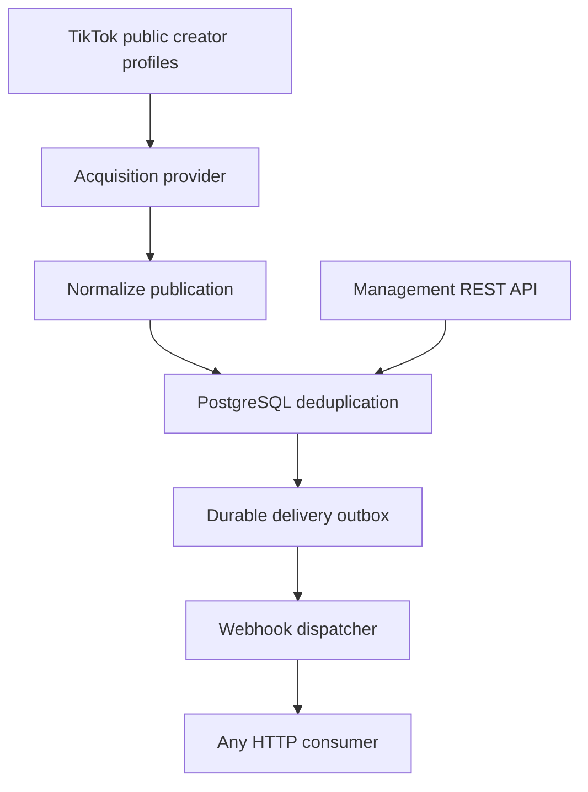

<div align="center">

# VoxyTok

### TikTok publications. Delivered to your webhook.

A self-hosted, destination-agnostic TikTok event service written in Rust. VoxyTok monitors configured public creator profiles, normalizes new-publication events and delivers them to any HTTP endpoint.

[](https://www.rust-lang.org/)
[](https://github.com/KuaFeur/VoxyTok/pkgs/container/voxytok)
[](LICENSE)

</div>

---

## What is VoxyTok?

VoxyTok is an independent event gateway. It is not tied to Voxy, Discord or any specific bot. Any application that can call an HTTP API or receive webhooks can use it.

The service is designed around the same operational model as [VoxyTube](https://github.com/KuaFeur/Voxytube): a standalone Rust service, durable PostgreSQL storage, authenticated management API, normalized events, retryable webhook delivery and a Pelican / Pterodactyl deployment option.

## Design goals

- **Destination-agnostic:** no Discord-specific code or assumptions.
- **One monitored profile, many consumers:** creator monitoring is centralized; consumers subscribe to events independently.
- **Durable:** persist publication identity before attempting delivery.
- **Idempotent:** never emit the same publication twice to the same subscription.
- **Honest delivery semantics:** at-least-once webhook delivery with an idempotency key.
- **Self-hosted:** Docker image and Pelican / Pterodactyl Egg.
- **Provider isolation:** TikTok data acquisition is behind a provider interface so it can be replaced without changing the public API.

## Important platform limitation

TikTok does not currently provide a general-purpose public push feed equivalent to YouTube WebSub for arbitrary public creators. VoxyTok therefore cannot promise YouTube-style instant push notifications for every TikTok profile.

The acquisition provider must be selected and validated against TikTok's current access rules, reliability, rate limits and operational constraints. VoxyTok will not silently depend on browser automation, login-cookie harvesting or an undocumented endpoint while presenting it as a stable official API.

The service will expose provider health and observation timestamps so consumers can distinguish a newly detected publication from its original TikTok publication time.

## Planned architecture



PostgreSQL is the durable source of truth and stores creators, subscriptions, observed publications and delivery attempts. The first implementation follows VoxyTube's embedded-PostgreSQL container model; a Redis dependency will not be added unless the implementation demonstrates a concrete need for it.

## Planned API

All management endpoints use Bearer authentication.

| Method | Endpoint | Purpose |
| --- | --- | --- |
| `POST` | `/api/v1/creators` | Register a TikTok creator |
| `GET` | `/api/v1/creators` | List monitored creators |
| `DELETE` | `/api/v1/creators/{id}` | Stop monitoring a creator |
| `POST` | `/api/v1/subscriptions` | Subscribe a webhook to creator events |
| `GET` | `/api/v1/subscriptions` | List webhook subscriptions |
| `DELETE` | `/api/v1/subscriptions/{id}` | Remove a webhook subscription |
| `GET` | `/api/v1/events` | Inspect observed publications and deliveries |
| `POST` | `/api/v1/events/{id}/retry` | Retry a failed delivery |
| `GET` | `/healthz` | Liveness check |
| `GET` | `/readyz` | Readiness check |

The API contract will be finalized alongside the implementation and documented in the GitBook.

## Webhook event

The normalized event contract is planned to be platform-neutral where possible while retaining TikTok-specific metadata:

```json
{
  "event": "tiktok.video.published",
  "event_id": "evt_...",
  "creator": {
    "username": "creator",
    "display_name": "Creator"
  },
  "video": {
    "id": "video_id",
    "description": "New video",
    "url": "https://www.tiktok.com/@creator/video/video_id",
    "cover_url": null,
    "published_at": null
  },
  "detected_at": "2026-01-01T12:00:00Z",
  "source": "provider"
}
```

Exact optional fields depend on what the selected acquisition provider can reliably supply. Missing metadata will be represented as `null`, not fabricated.

Each webhook delivery will include an `Idempotency-Key`. Delivery is at-least-once: consumers should deduplicate using that key.

## Deployment

A Pelican / Pterodactyl Egg and a Docker image are part of the project deliverables.

Planned image:

```text
ghcr.io/kuafeur/voxytok:latest
```

The container will bundle the Rust service and PostgreSQL, following VoxyTube's single-container deployment convention. Persist the application data directory; do not expose PostgreSQL's internal port publicly.

## Project status

VoxyTok is at the initial implementation stage. The API, provider, migrations, delivery worker, Docker image, Egg, automated tests and operational documentation must be completed and validated before a production-ready release is claimed.

## License

Apache-2.0. See [LICENSE](LICENSE).
