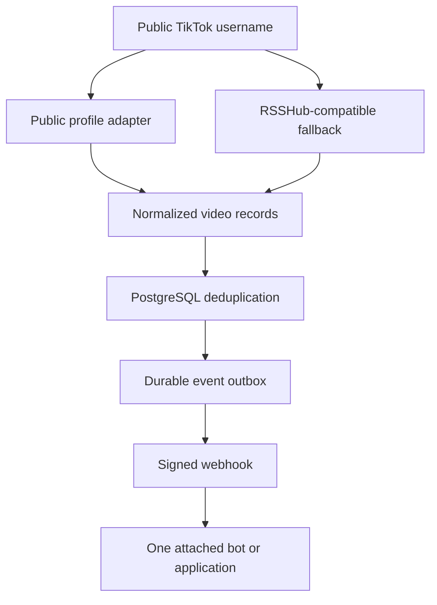

# VoxyTok

**TikTok public profile monitoring for bots and applications.**

VoxyTok is a self-hosted Rust service that monitors public TikTok profiles and forwards newly detected videos to one configured webhook. A creator is added by username only: no TikTok OAuth, account linking, cookie, manual video submission or user-side source setup.

## Design

**One VoxyTok instance = one bot/application.**

- Generic HTTP API and webhook; no Discord dependency.
- PostgreSQL is the durable source of truth; Redis is not required.
- One configured webhook destination per instance.
- RSS/Atom is an internal acquisition mechanism only; consuming bots never need to read RSS.
- Multiple retrieval paths normalize into one event pipeline.
- PostgreSQL deduplication prevents duplicate notifications when adapters find the same video.

## How it works

1. Your bot calls `POST /api/v1/creators` with `{"username":"@creator"}`.
2. VoxyTok schedules a first public-profile lookup.
3. The first successful lookup establishes a baseline; historical videos are not replayed.
4. Later discoveries are normalized, deduplicated and queued.
5. VoxyTok sends signed webhook events to the one destination configured for this instance.

## Acquisition and rate limits

The initial retrieval paths are a direct TikTok embed parser and several RSSHub-compatible RSS/Atom instances. RSSHub's TikTok route also reads TikTok's public embed page, so these are separate intermediaries/caches rather than independent underlying TikTok data providers. Each source has independent health state, cooldown, retry schedule and error classification. The scheduler respects `Retry-After`, applies backoff and avoids hammering sources that are failing.

No public TikTok source is unlimited or guaranteed. TikTok can change page structures, rate-limit automated requests, challenge traffic or make a profile unavailable. VoxyTok reports degraded acquisition and retries later; it does not rotate identities, evade CAPTCHAs or bypass access controls.

Default polling interval is five minutes. The operator can set `PUBLIC_POLL_INTERVAL_SECONDS` (60-3600). This is best-effort polling, not an official real-time push subscription.

## Features

- Username-only public creator onboarding.
- Multiple acquisition adapters behind one normalized interface.
- Direct TikTok embed parser and several RSSHub-compatible RSS/Atom fallback instances.
- Per-source health counters, latency, cooldown and failure backoff.
- Initial synchronization baseline with no historical replay.
- PostgreSQL video deduplication and durable webhook outbox.
- HMAC-SHA256 webhook signatures, stable idempotency keys and retry recovery.
- Rust API, Docker image and Pelican/Pterodactyl Egg with embedded PostgreSQL.

## Container image

`ghcr.io/kuafeur/voxytok:latest`

Persist `VOXYTOK_DATA_DIR` across restarts and upgrades. It contains application data and, by default, the embedded PostgreSQL cluster. If `POSTGRES_DATA_DIR` is set, persist that actual PostgreSQL path separately as well.

The main-branch workflow publishes `:latest` only after Rust checks, the container build and embedded-PostgreSQL/API smoke tests pass. A version tag is published only when the exact commit already has a successful main-branch CI run. Prerelease tags such as `v1.0.0-rc.2` never replace stable `:latest`. For production, verify the source commit and successful CI run, then pin the corresponding immutable image digest. See the [Pelican deployment and rollback runbook](docs/DEPLOYMENT.md).

## Quick start

1. Deploy the container and persist `VOXYTOK_DATA_DIR` and the actual PostgreSQL data directory if `POSTGRES_DATA_DIR` is configured.
2. Configure `API_TOKEN`, `POSTGRES_PASSWORD`, `WEBHOOK_URL` and `WEBHOOK_SECRET`.
3. Start adding creators with `POST /api/v1/creators` and a username.
4. Receive `tiktok.video.published` events at the configured webhook.

TikTok OAuth has been removed completely: no developer credentials, account linking, callback routes or stored OAuth tokens. Monitoring uses public-profile acquisition only.

## API overview

All `/api/v1/*` routes require `Authorization: Bearer <API_TOKEN>`.

| Method | Endpoint | Purpose |
| --- | --- | --- |
| `POST` | `/api/v1/creators` | Add a public TikTok username |
| `GET` | `/api/v1/creators` | List monitored creators |
| `GET` | `/api/v1/creators/{id}/sources` | Inspect source health, cooldowns and retry state |
| `DELETE` | `/api/v1/creators/{id}` | Stop monitoring and delete creator data |
| `GET` | `/api/v1/events` | Inspect events and delivery states |
| `POST` | `/api/v1/events` | Internal normalized event ingestion |
| `POST` | `/api/v1/events/{id}/retry` | Retry a webhook delivery |
| `GET` | `/healthz` | Liveness |
| `GET` | `/readyz` | PostgreSQL readiness |

See [API reference](docs/API.md), [OpenAPI specification](docs/openapi.yaml), [integration guide](docs/INTEGRATION.md), [V1 test plan](docs/TESTING_V1.md) and [deployment runbook](docs/DEPLOYMENT.md).

## Development status

The VoxyTok RC2 is `1.0.0-rc.2`. The main-branch CI validates Rust formatting, compilation, unit tests and Clippy, builds the container, smoke-tests embedded PostgreSQL and the HTTP API, then publishes `ghcr.io/kuafeur/voxytok:latest` to GHCR. A version tag is published only when that exact commit already has a successful main-branch CI run. Prerelease tags such as `v1.0.0-rc.1` do not replace stable `:latest`.

## License

Apache-2.0. See [LICENSE](LICENSE).
