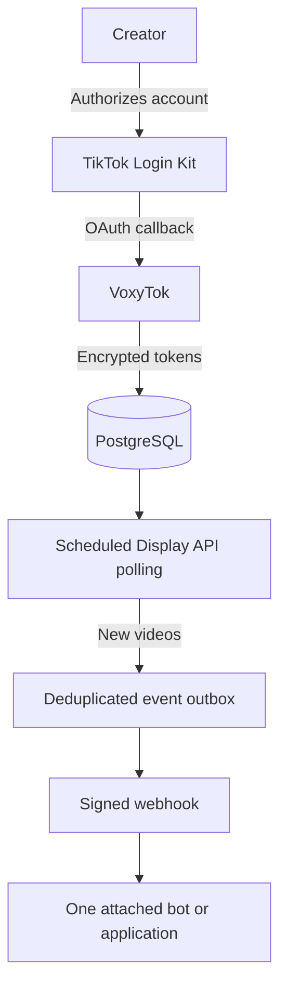

# VoxyTok

### TikTok publications. Delivered to your application.

A self-hosted TikTok event gateway written in Rust. VoxyTok uses TikTok's official Login Kit and Display API to monitor accounts that explicitly authorize the instance, then forwards normalized publication events to one configured webhook.

---

## Design principles

**One VoxyTok instance = one bot or application.**

VoxyTok is generic and open source. A deployment belongs to one consuming application and has its own database, creator list, API token and webhook destination.

- No Discord dependency or Discord user IDs in the core.
- No shared multi-tenant SaaS, cross-customer subscriptions or event fan-out.
- The consumer can be a Discord bot, Telegram bot, website, dashboard or any HTTP service.
- The consuming application owns its user accounts, permissions, channels and presentation logic.
- PostgreSQL is the durable source of truth; Redis is not required for this single-instance worker model.

## How it works

1. The application creates a cryptographically random, opaque reference and stores its own association (for example, the app's local user ID).
2. The application sends that reference to VoxyTok when requesting a TikTok authorization URL.
3. The creator opens the link and authorizes their own TikTok account.
4. VoxyTok stores encrypted OAuth tokens and binds the connected creator to the reference digest.
5. The application polls the connection-status endpoint using the same reference and receives the VoxyTok creator ID.
6. VoxyTok periodically checks the authorized account's videos and delivers new publications to the application's webhook.
7. The application decides what to do: post a Discord message, notify a Telegram chat, update a website, etc.

## TikTok API limitations

VoxyTok deliberately does not scrape TikTok pages, reuse browser cookies or rely on undocumented endpoints.

The current provider uses TikTok Login Kit and the Display API. This has an important consequence: **a creator must authorize their own TikTok account**. It does not provide access to arbitrary public profiles that have not authorized the application.

The provider polls periodically (currently every 12 hours); this is not an instant TikTok push feed. TikTok developer app approval, enabled products and scopes are required. Review TikTok's current eligibility and rate limits before deploying publicly.

## Features

- Official TikTok OAuth authorization and callback.
- AES-256-GCM encryption for access and refresh tokens at rest.
- Single-use, expiring OAuth state.
- Automatic refresh-token rotation, with permanent revocation detection and an explicit reauthorization state.
- Scheduled video polling with bounded pagination; the first connection does not replay the existing back catalogue.
- Persistent exponential backoff after transient provider errors; revoked credentials are disabled until the creator reconnects.
- PostgreSQL deduplication and durable delivery outbox.
- Signed webhooks (HMAC-SHA256) and stable idempotency keys.
- Retry handling and recovery of deliveries interrupted by a process restart.
- Rust API, Docker runtime and Pelican / Pterodactyl Egg.

## Container image

Versioned releases are published to GitHub Container Registry as
`ghcr.io/kuafeur/voxytok:<version>`, with `latest` pointing to the newest
tagged release. The Pelican / Pterodactyl Egg uses this image. Keep
`VOXYTOK_DATA_DIR` on persistent storage: it contains the embedded PostgreSQL
cluster and must survive container restarts and image updates.

## Quick start

1. Deploy VoxyTok and persist `VOXYTOK_DATA_DIR`.
2. Set `API_TOKEN`, `POSTGRES_PASSWORD`, `WEBHOOK_URL` and `WEBHOOK_SECRET`.
3. Create a TikTok developer application with Login Kit and Display API enabled.
4. Register the exact HTTPS callback URL configured in `TIKTOK_REDIRECT_URI`.
5. Set `TIKTOK_CLIENT_KEY`, `TIKTOK_CLIENT_SECRET`, `TIKTOK_REDIRECT_URI` and a persistent `TOKEN_ENCRYPTION_KEY`.
6. From your application backend, generate a random reference (at least 32 URL-safe characters), store its mapping to your own local user/session, then call `POST /api/v1/oauth/tiktok/start` with `{"reference":"..."}`. Send the returned authorization URL to the creator. Poll `GET /api/v1/oauth/tiktok/connections/{reference}` to retrieve the connected creator ID.
7. Receive publication events at the one `WEBHOOK_URL` configured for this VoxyTok instance.

Never expose `API_TOKEN`, TikTok client secrets or `TOKEN_ENCRYPTION_KEY` to end users or browser JavaScript.

See [API reference](docs/API.md), [OpenAPI 3.1 specification](docs/openapi.yaml) and [integration guide](docs/INTEGRATION.md). A Discord.js example is available in [examples/discord.js](examples/discord.js/).

## API overview

All `/api/v1/*` management endpoints require `Authorization: Bearer <API_TOKEN>`.

| Method | Endpoint | Purpose |
| --- | --- | --- |
| `POST` | `/api/v1/oauth/tiktok/start` | Create an authorization URL linked to an opaque app reference |
| `GET` | `/api/v1/oauth/tiktok/connections/{reference}` | Check the connection status and retrieve the creator ID |
| `GET` | `/oauth/tiktok/callback` | TikTok OAuth callback (public, state-validated) |
| `GET` | `/api/v1/creators` | List creators connected to this instance |
| `POST` | `/api/v1/creators` | Create a local, manually managed creator record |
| `DELETE` | `/api/v1/creators/{id}` | Remove a creator and its stored data |
| `POST` | `/api/v1/events` | Ingest a normalized event (provider adapter) |
| `GET` | `/api/v1/events` | Inspect recent events and delivery states |
| `POST` | `/api/v1/events/{id}/retry` | Retry a failed delivery |
| `GET` | `/healthz` | Liveness check |
| `GET` | `/readyz` | Database readiness check |

The OAuth callback returns a JSON confirmation to the browser. The application can poll the protected connection-status endpoint using its opaque reference to retrieve the creator ID. VoxyTok stores only the reference digest; the consuming app retains the mapping to its own local user. No Discord identifiers or other platform-specific identity fields enter VoxyTok.

## Webhook contract

VoxyTok sends the normalized event JSON as the request body and adds:

- `Content-Type: application/json`
- `Idempotency-Key: <delivery UUID>`
- `X-VoxyTok-Signature: sha256=<hex HMAC-SHA256>` when `WEBHOOK_SECRET` is configured.

The signature is computed over the exact raw HTTP request body. Verify it before parsing JSON. Delivery is **at least once**, not exactly once: consumers should deduplicate by `Idempotency-Key`. Failed deliveries are retried with exponential backoff; after ten failed attempts they are marked failed and can be retried through the API.

## Docker and Pelican / Pterodactyl

The runtime image bundles VoxyTok and PostgreSQL. Persist `VOXYTOK_DATA_DIR` across restarts and upgrades. Import `deploy/pelican/egg-voxytok.json` and allocate only the HTTP port. PostgreSQL listens on localhost inside the container and must not be exposed publicly.

The CI currently builds the image without publishing it. Publish your own image or use a release workflow before selecting a GHCR tag in production.

## Development status

Implemented:
- TikTok OAuth and encrypted token storage.
- Token refresh and scheduled Display API polling.
- Bounded pagination and persisted provider backoff.
- Event deduplication, durable webhook outbox and retry recovery.
- API, Docker runtime, Pelican Egg and PostgreSQL-backed CI tests.

Still required before a production release:
- Real TikTok developer application approval and end-to-end validation with authorized test accounts.
- Operational testing of webhook delivery against real consumer applications.
- Production image publishing and release process.
- GitBook documentation and deployment validation on Pelican / Pterodactyl.

## License

Apache-2.0. See [LICENSE](LICENSE).
