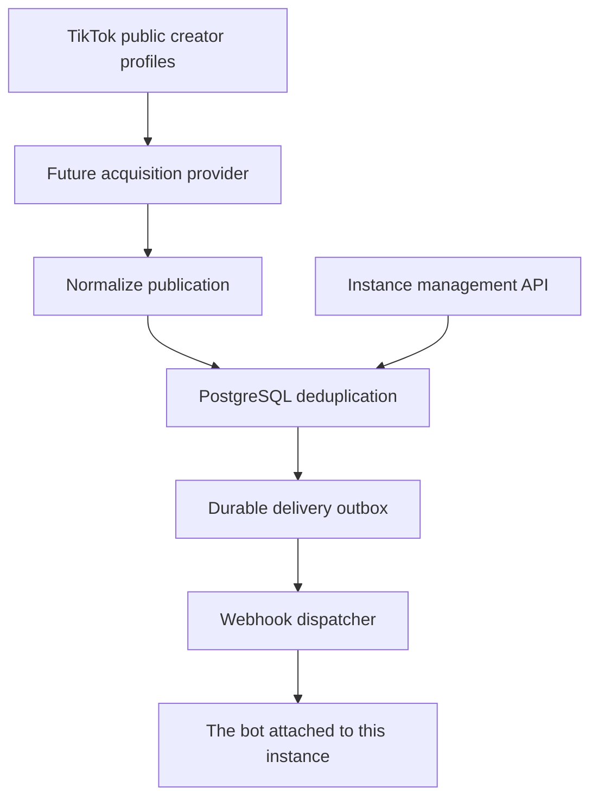

<div align="center">

# VoxyTok

### TikTok publications. Delivered to your bot.

A self-hosted TikTok event gateway written in Rust. VoxyTok monitors TikTok accounts that explicitly authorize the instance through TikTok Login Kit and sends normalized publication events to the webhook of the bot/application attached to that instance.

[](https://www.rust-lang.org/)
[](https://github.com/KuaFeur/VoxyTok/pkgs/container/voxytok)
[](LICENSE)

</div>

---

## The instance model

**One VoxyTok instance = one bot or application.**

VoxyTok is generic and open source: any developer can deploy their own instance and connect it to their own bot. Each deployment has its own database, creator list, API token and webhook destination.

There is no shared multi-tenant service, no cross-customer subscriptions and no fan-out between unrelated bots. Data and events stay inside the instance operated for that bot.

## Capabilities

- **Bot-agnostic:** the consumer can be a Discord bot, a website, or any HTTP application.
- **Single destination per instance:** one configured webhook receives events for the bot attached to that deployment.
- **Durable event pipeline:** publications are persisted and deduplicated before delivery.
- **Retryable delivery:** transient webhook failures are retried with exponential backoff.
- **Idempotency:** each delivery carries a stable `Idempotency-Key`.
- **Signed webhooks:** optional HMAC-SHA256 signature via `X-VoxyTok-Signature`.
- **Self-hosted:** Docker image and Pelican / Pterodactyl Egg with PostgreSQL bundled in the container.
- **Provider isolation:** TikTok acquisition can be implemented or replaced without changing the consumer API.

## TikTok acquisition status and limitations

TikTok does not offer a general-purpose public push feed equivalent to YouTube WebSub for arbitrary public creator profiles. VoxyTok therefore does not claim instant notifications or universal profile coverage.

The current milestone implements the management API, durable event ingestion, deduplication and webhook delivery pipeline. The TikTok acquisition provider is a separate integration milestone and must be validated against current access rules, rate limits and reliability. VoxyTok will not silently depend on browser automation, harvested login cookies or an undocumented endpoint while presenting it as a stable official API.

Until a provider is integrated, events can be submitted to the authenticated ingestion endpoint by a provider adapter or test harness.

## Architecture



Each deployment runs one VoxyTok API and one webhook dispatcher. PostgreSQL is the durable source of truth. Redis is intentionally not required: the database outbox is sufficient for the current single-instance worker model.

## API

All management endpoints require `Authorization: Bearer <API_TOKEN>`.

| Method | Endpoint | Purpose |
| --- | --- | --- |
| `POST` | `/api/v1/oauth/tiktok/start` | Generate a one-time TikTok authorization URL |\n| `GET` | `/oauth/tiktok/callback` | Complete TikTok Login Kit authorization |\n| `POST` | `/api/v1/creators` | Add an unconnected local creator record (not polled until OAuth) |
| `GET` | `/api/v1/creators` | List this instance's creators |
| `DELETE` | `/api/v1/creators/{id}` | Stop monitoring and remove a creator |
| `POST` | `/api/v1/events` | Ingest a normalized publication event |
| `GET` | `/api/v1/events` | Inspect the latest 100 events and delivery states |
| `POST` | `/api/v1/events/{id}/retry` | Retry a failed delivery |
| `GET` | `/healthz` | Liveness check |
| `GET` | `/readyz` | Database readiness check |

### Register a creator

```bash
curl -X POST http://localhost:8080/api/v1/creators \
  -H "Authorization: Bearer $API_TOKEN" \
  -H "Content-Type: application/json" \
  -d '{"username":"tiktok_creator"}'
```

### Submit a normalized publication

This endpoint is intended for the acquisition adapter and integration tests. It is not a replacement for the TikTok provider itself.

```bash
curl -X POST http://localhost:8080/api/v1/events \
  -H "Authorization: Bearer $API_TOKEN" \
  -H "Content-Type: application/json" \
  -d '{
    "creator_id":"CREATOR_UUID",
    "platform_video_id":"7350000000000000000",
    "published_at":null,
    "payload":{
      "event":"tiktok.video.published",
      "creator":{"username":"tiktok_creator"},
      "video":{
        "id":"7350000000000000000",
        "url":"https://www.tiktok.com/@tiktok_creator/video/7350000000000000000"
      }
    }
  }'
```

A duplicate `(creator_id, platform_video_id)` is acknowledged without creating another delivery.

## Webhook contract

VoxyTok forwards the normalized JSON payload supplied by the provider adapter. It adds:

- `Content-Type: application/json`
- `Idempotency-Key: <delivery UUID>`
- `X-VoxyTok-Signature: sha256=<hex HMAC>` when `WEBHOOK_SECRET` is configured.

The signature is HMAC-SHA256 over the exact HTTP request body. Consumers should compare signatures in constant time and deduplicate using the idempotency key.

Delivery is at-least-once. Failed requests are retried with exponential backoff, capped at one hour; after ten failed attempts the delivery is marked `failed` and can be manually retried.

## Configuration

Copy `.env.example` and configure at least:

| Variable | Required | Description |
| --- | --- | --- |
| `API_TOKEN` | Yes | Management API bearer token, minimum 32 characters |\n| `TIKTOK_CLIENT_KEY` | For acquisition | TikTok developer app client key |\n| `TIKTOK_CLIENT_SECRET` | For acquisition | TikTok developer app secret |\n| `TIKTOK_REDIRECT_URI` | For acquisition | Exact registered HTTPS OAuth callback URI |\n| `TOKEN_ENCRYPTION_KEY` | For acquisition | 32-byte key encoded as 64 hex characters; keep stable and backed up |
| `WEBHOOK_URL` | For delivery | The one webhook belonging to this bot instance |
| `WEBHOOK_SECRET` | No | HMAC-SHA256 signing secret |
| `POSTGRES_PASSWORD` | Yes | Local embedded PostgreSQL password |
| `POSTGRES_DB` | No | Database name |
| `POSTGRES_USER` | No | Database user |
| `POSTGRES_PORT` | No | Internal PostgreSQL port, not public |
| `PORT` | No | HTTP port, defaults to 8080 |
| `VOXYTOK_DATA_DIR` | No | Persistent data directory |

The webhook worker remains disabled when `WEBHOOK_URL` is empty. PostgreSQL listens on localhost inside the container and must not be exposed publicly.

## Docker and Pelican / Pterodactyl

Planned image:

```text
ghcr.io/kuafeur/voxytok:latest
```

The container bundles the Rust service and PostgreSQL. Persist `VOXYTOK_DATA_DIR` across restarts and upgrades. Import `deploy/pelican/egg-voxytok.json` into Pelican / Pterodactyl and allocate only the HTTP port.

## Project status

Implemented in the current development milestone:
- Authenticated creator management API.
- PostgreSQL schema and durable publication deduplication.
- Authenticated event ingestion endpoint.
- Single-destination webhook dispatcher.
- HMAC-SHA256 signatures, idempotency keys and retry queue.
- Docker runtime with embedded PostgreSQL and Pelican Egg configuration.
- CI checks for formatting, compilation, tests and linting.

Still required before a production release:
- A reliable, compliant TikTok acquisition provider.
- Integration tests against a real PostgreSQL instance and webhook receiver.
- End-to-end container and Egg validation.
- GitBook documentation and release hardening.

## License

Apache-2.0. See [LICENSE](LICENSE).
